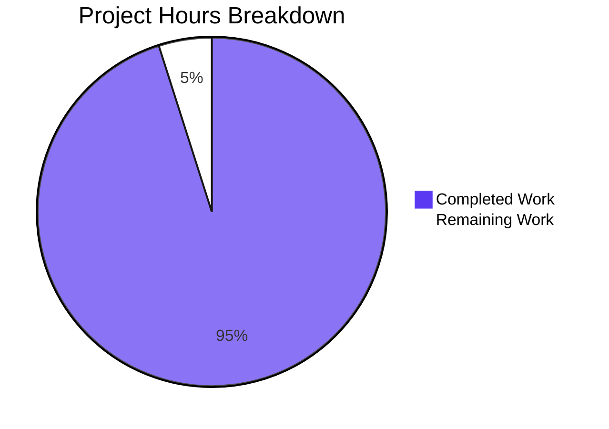
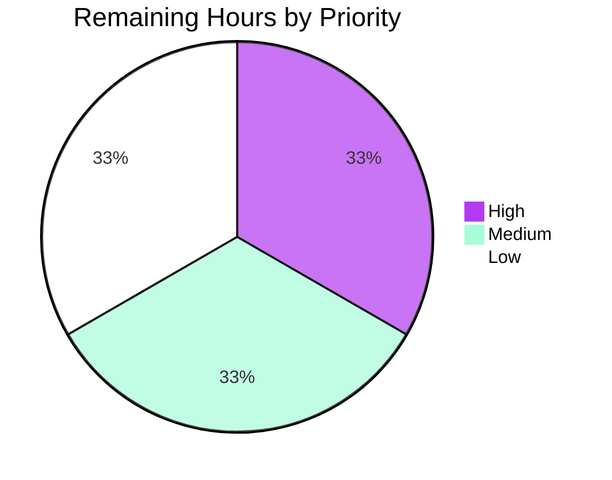

# 1. Executive Summary

## 1.1 Project Overview

A minimal, dependency-free Node.js HTTP server: one file that serves a single greeting endpoint and answers everything else with a plain-text `404`, so a learner can read the whole request-to-response path in one sitting. The audience is beginners, and the instructors who teach them. The scope is Node.js 18.0.0 or newer, the built-in `http` module as the only import, `text/plain` responses, console logging in a fixed format, a validated port, and a clean `SIGINT` shutdown — all in three root files: `server.js`, `package.json` and `README.md`.

## 1.2 Completion Status



| Metric | Value |
|---|---|
| Total Hours | 122 |
| Completed Hours (AI + Manual) | 116 |
| Remaining Hours | 6 |
| Completion | **95%** (116 ÷ 122) |

## 1.3 Key Accomplishments

- `GET /hello` answers `200`, `Content-Type: text/plain` and an 11-byte `Hello world` body, with no trailing newline (`server.js:41`, `server.js:111-114`).
- Every other method-and-path combination takes one catch-all `404` `Not Found`, with no `405` branch (`server.js:130-135`).
- The route match is literal: the query string is split off and nothing is decoded, so the logged path is exactly what the client sent (`server.js:85-88`).
- One ISO-8601 timestamp/method/path line is written for every request before routing (`server.js:97-99`).
- The `PORT` surface is total: default `3000`, digits-only `1024`–`65535`, and an actionable refusal with exit `1` for anything else, binding nothing (`server.js:49-73`).
- Startup, shutdown and both bind-error paths are actionable, with no stack traces (`server.js:177-192`, `server.js:201-203`, `server.js:215-233`).
- A guarded failure path keeps internal detail off the wire (`server.js:138-152`).
- The README's eight topics were followed as written and every documented output reproduced.

## 1.4 Critical Unresolved Issues

No requirement is unresolved. **7 of the 22 requirement statements** carry an accepted caveat — each a boundary of the delivered design rather than a defect, and none blocking delivery for the purpose this product states.

| Issue | Impact | Owner | ETA |
|---|---|---|---|
| 4 caveats — generic bind-failure message not reproducible from the delivered configuration surface; parser-rejected traffic (`400`/`431`, malformed lines, `CONNECT`) produces no log line; `HEAD` responses carry no framing header; a second `SIGINT` or a `SIGTERM` exits with `130`/`143` and no shutdown line | Observability and client-behaviour edges; no contracted flow is affected | Maintainer | Next maintenance window |
| 1 caveat — the process accepts connections on every network interface, with no TLS, authentication, rate limiting or request timeouts (`README.md:48` states the reachability) | Reachable beyond loopback on a shared or untrusted network; the served content is a public constant and the process holds no state | Maintainer / operator | Decide at deployment |
| 1 caveat — the declared Node.js floor (`engines.node ">=18.0.0"`) was verified on v22.23.3 only | An 18.x-only environment is unproven until re-run there | Maintainer | Before reuse on 18.x |
| 1 caveat — no automated regression suite ships, by design | A future edit to `server.js` is unguarded until the acceptance battery is scripted | Maintainer | Before the next code change |

## 1.5 Access Issues

No access issues identified. The project needs no credential, no service account and no external system: it runs from a clone with Node.js, npm and curl present, and its whole configuration surface is one optional environment variable.

## 1.6 Recommended Next Steps

1. **[High]** Confirm the declared Node.js floor on the 18.x LTS line and re-run the contract, configuration and shutdown checks there.
2. **[Medium]** Script the acceptance battery outside the delivered three files, so a future edit is checkable rather than merely reviewable.
3. **[Medium]** Decide the deployment posture: keep the all-interface bind with its documented guidance, or narrow it to loopback.
4. **[Low]** Exercise the generic bind-failure message on a host condition that raises it.
5. **[Low]** State the `HEAD`/connection-close and `npm start` exit-status behaviours explicitly in the documentation.

# 2. Project Hours Breakdown

## 2.1 Completed Work Detail

| Component | Hours | Description |
|---|---|---|
| Server entry point and configuration core | 16 | Module-scope constants and a frozen route table, so no request-derived value can influence what is served; port resolution with a default, a digits-only range check and an actionable refusal decided before any socket exists (`server.js:5-73`, `server.js:235-243`) |
| Request path and response contract | 24 | The literal-match route lookup, the `200`/`404`/`500` branches and the request line written before routing; `sendText` is the file's single write path, so both endpoints and the failure path are framed identically (`server.js:85-153`) |
| Process lifecycle and shutdown | 22 | One server per process; a tracked socket set so `SIGINT` releases idle keep-alive connections on any 18.x runtime; an `'error'` listener registered before `listen()`; a close callback that never reports success over a fatal status (`server.js:160-233`) |
| Error diagnostics | 12 | Four fixed messages — invalid `PORT`, `EADDRINUSE`, any other bind failure, and a handler failure — each actionable, each free of stack detail, each emitted on the stream the contract names (`server.js:64-70`, `server.js:138-152`, `server.js:177-192`) |
| Documentation deliverable | 20 | The README's eight topics as a zero-knowledge walkthrough: prerequisites, no install required, both start paths, the endpoint cases with copy-pasteable `curl` commands, expected output, shutdown and `PORT` configuration (`README.md`) |
| Manifest and deliverable-set integrity | 2 | The seven fixed manifest fields with no dependency block, no `"type"` and no extra metadata, in a flat three-file layout (`package.json`) |
| Acceptance verification | 16 | 98 checks executed against the running server: both response contracts, the literal-match cases, log-line shape, six configuration branches, latency, concurrency, memory stability, fault injection and the documentation walkthrough |
| Security-boundary and code-quality conformance | 4 | The six boundaries verified as enforced constraints, plus style, purposeful naming, JSDoc headers and reason-only comments across the file |
| **Total** | **116** | |

## 2.2 Remaining Work Detail

| Category | Hours | Priority |
|---|---|---|
| Confirm the declared Node.js runtime floor on the 18.x LTS line (boot the three files there and re-run the contract, configuration and shutdown checks) | 2.0 | High |
| Automate the acceptance battery as a repeatable script kept outside the delivered three files, so a future edit is checkable | 2.0 | Medium |
| Exercise the generic bind-failure message on a host condition that raises it | 1.0 | Low |
| Decide and document the boundary behaviours: binding scope, `HEAD`/connection-close framing and `npm start`'s own exit status | 1.0 | Low |
| **Total** | **6.0** | |

# 3. Test Results

| Area / Category | Framework | Tests | Passed | Failed | Coverage | What This Proves |
|---|---|---|---|---|---|---|
| Startup and process lifecycle (F1, F5) | node + curl | 9 | 9 | 0 | n/a | One process binds the resolved port, announces it once on stdout, and stops on CTRL+C with the shutdown line, exit status `0` and the port released |
| Greeting endpoint (F2) | node + curl | 8 | 8 | 0 | n/a | `GET /hello` answers `200` with `text/plain` and an 11-byte constant body, no trailing newline, no `Server` banner and no CORS header |
| Catch-all, method matching and literal path comparison (F3) | node + curl | 13 | 13 | 0 | n/a | Every other method-and-path combination takes `404` `Not Found`; the query string is split off and nothing is resolved, decoded or alias-matched |
| Request logging (F4) | node + curl | 5 | 5 | 0 | n/a | Exactly one correctly shaped ISO-8601/method/path line per request, written before routing, with the literal path as sent and no query string |
| `PORT` configuration — default, override and 13 refused values (F7) | node + curl | 45 | 45 | 0 | n/a | The default and an override both bind and serve; every non-digits-only, out-of-range, zero and privileged value exits `1` with the byte-stable message and nothing bound |
| Bind-failure diagnosis (R13) | node + curl | 4 | 4 | 0 | n/a | An occupied port prints the actionable `EADDRINUSE` line, exits `1`, writes nothing to stdout and emits no stack trace |
| Guarded handler failure (R12) | node + curl, fault-injected copy | 7 | 7 | 0 | n/a | An unexpected throw answers `500` with the fixed body, logs one detail-only line per request and reflects no internal detail to the client |
| Non-functional budgets and the `npm start` path (R15) | node + curl | 7 | 7 | 0 | n/a | Latency measured both ways — 20 keep-alive samples with a median of 0.697 ms and a maximum of 5.563 ms, and a 20-request `curl` loop whose slowest sample was 0.003909 s, all inside the 10 ms budget; 50 simultaneous requests all `200`; a 25/25 mixed batch splits cleanly; RSS moves under 0.5 MB across 1,000 requests; `npm start` reaches the same server |

Across those eight categories **98 checks were executed, 98 passed and none failed**. No coverage percentage is reported: no coverage tool ships with this project, because a three-file dependency-free deliverable admits none. The checks were run against the running server on this checkout and grouped by the capability they exercise; taken together with the static readings, these are the areas exercised most heavily — the `PORT` refusal matrix, the literal-match cases and the fault-injected failure path.

**Not Covered**

- **Parser-rejected traffic.** Requests the runtime refuses before the request listener (`400`/`431`, malformed request lines, `CONNECT`) produce no application log line, so "every request is logged" holds only for requests the parser accepts. Exercise it with a raw-socket client before treating the console as a traffic record.
- **`HEAD` requests.** No framing header is emitted — the runtime suppresses the body and the server sets only `Content-Type` — so a client that delimits a response by connection close waits for the keep-alive timeout. Test with the clients you intend to point at the server.
- **The generic non-`EADDRINUSE` bind branch.** Unreachable from the delivered configuration surface: values below `1024` are refused before `listen()` and values at or above it either bind or raise `EADDRINUSE`. Reproduce it on a host condition that raises another bind error — an unavailable local address, for example — to observe the message text.
- **The 18.x runtime line.** Only v22.23.3 was available here, so the declared `>=18.0.0` floor is a manifest declaration satisfied by the running interpreter rather than one proven by booting 18.x.
- **A second `SIGINT`, and `SIGTERM`.** Both leave through the OS default handler with `130`/`143` and no shutdown line; a process manager wrapping this server should expect that.
- **No browser surface exists.** The product returns `text/plain` only and ships no HTML, stylesheet, script or view layer, so there is no screen to render, no visual behaviour to verify and no visual evidence to collect.

# 4. Runtime Validation & UI Verification

The product has no graphical interface — it answers `text/plain` and renders no view — so the verification below is the running process observed from a client and from its own console, which is the whole of its observable surface. There is no external integration to exercise: the application calls nothing, and its only boundaries are the listening socket, the two console streams, the `SIGINT` signal and the `PORT` variable.

- ✅ **Startup and binding** — `node server.js` and `npm start` both bind the resolved port and print `Server listening on port <port>` once on stdout; the default-port path was driven on `3000` from a copy outside the repository.
- ✅ **Greeting endpoint** — `curl -i http://localhost:3000/hello` returned `HTTP/1.1 200 OK`, `Content-Type: text/plain` and the 11-byte body `Hello world` with no trailing newline.
- ✅ **Catch-all and method matching** — an undefined path, `POST /hello`, `PUT /hello`, a trailing slash, a case variant and a `--path-as-is` dot segment each answered `404` with `Not Found`.
- ✅ **Query-string handling** — `/hello?x=1` and `/hello?x=1&y=2` answered `200`, each logged as `/hello` with the query string split off.
- ✅ **Request logging** — one line per request in the fixed ISO-8601/method/path shape, written before routing, across 1,137 requests in a single serving run, with stderr empty throughout.
- ✅ **Configuration** — the default `3000`, an override on `4000` that served while nothing answered on `3000`, and 13 refused values that each exited `1` with the fixed message and left nothing bound.
- ✅ **Occupied port** — a second instance against a live one exited `1` with the actionable `EADDRINUSE` line, empty stdout and no stack trace.
- ✅ **Shutdown** — CTRL+C (scripted as `kill -INT`) printed `Server shutting down (SIGINT received)` exactly once, exited `0` and released the port; externally held keep-alive sockets were destroyed, so the close callback could not hang.
- ✅ **Guarded failure path** — a fault-injected copy outside the repository answered `500` with the fixed `Internal Server Error` body and wrote one detail-only line per request to stderr.
- ⚠ **Not exercised at runtime** — parser-rejected traffic leaves no log line; `HEAD` responses carry no framing header; a second `SIGINT` or a `SIGTERM` exits `130`/`143` without the shutdown line; the generic bind-failure branch is unreachable from the delivered configuration surface; and the declared 18.x floor was verified on v22.23.3 only. Nothing else was left unexercised for the capabilities this product delivers.

No flow or integration failed at runtime.

# 5. Compliance & Quality Review

## 5.1 Compliance Matrix

| Deliverable | Benchmark | Status | Verified |
|---|---|---|---|
| `GET /hello` response contract | Functional contract fidelity | ✅ Pass | `200` + `Content-Type: text/plain` + 11-byte constant body, 8/8 checks (`server.js:41`, `server.js:111-114`) |
| Catch-all `404` behaviour | Functional contract fidelity | ✅ Pass | 13/13 checks across unknown paths, unmatched methods, dot segments, trailing slash and case variants; no `405` branch (`server.js:130-135`) |
| Literal path matching | Contract fidelity, no aliasing | ✅ Pass | Query string split off, no decoding, resolution or re-encoding; logged path identical to what was sent (`server.js:85-88`) |
| Request and startup logging | Observability contract | ✅ Pass | 1,137 shaped request lines, one per request, written before routing; startup line emitted from the listen callback (`server.js:97-99`, `server.js:201-203`) |
| Error diagnostics | Error-handling quality | ✅ Pass | Four fixed, actionable messages with no stack detail: invalid `PORT`, `EADDRINUSE`, any other bind failure, handler failure (`server.js:64-70`, `server.js:138-152`, `server.js:177-192`) |
| Configuration surface | Configuration quality | ✅ Pass | 45/45 checks across the default, an override and 13 refused values; validation runs before any socket exists (`server.js:49-73`) |
| Graceful shutdown | Operational behaviour | ✅ Pass | Shutdown line once, exit status `0`, tracked sockets destroyed, `process.exit()` deliberately avoided (`server.js:215-233`) |
| Six security boundaries | Security compliance | ✅ Pass | No evaluation, filesystem access, outbound call, persistence, header/body processing or internal error detail in a body (whole-file inspection plus runtime checks) |
| Performance and scale | Performance budget | ✅ Pass | 20/20 keep-alive samples under 10 ms (median 0.697 ms, max 5.563 ms); 50/50 concurrent; RSS delta under 0.5 MB per 1,000 requests |
| Code quality and comments | Maintainability | ✅ Pass | `'use strict'`, consistent style, a JSDoc header per function and constant, reason-only comments, no dead code and no placeholder anywhere |
| Documentation deliverable | Documentation acceptance | ✅ Pass | Eight topics, every documented command and output reproduced at runtime, four fenced samples byte-equal to the emitted bytes (`README.md`) |
| Manifest and deliverable set | Packaging compliance | ✅ Pass | Seven fixed fields, no dependency block, no `"type"`, no lockfile, three root files and nothing else (`package.json`) |

## 5.2 AAP & Rule Divergences and Gaps

| What the AAP/Rule Required | What Was Delivered Instead | Why It Diverged | Impact | Remediation |
|---|---|---|---|---|
| Shutdown close callback "sets `process.exitCode = 0` in the callback" (AAP 0.5.1), read as an unconditional assignment | Sets `0` only when no exit status is already set: `if (process.exitCode === undefined)` (`server.js:223`) | AAP 0.1.2 requires "a deliberate exit status on every fatal path" and AAP 0.5.3 fixes `1` for an occupied port, so a status a fatal path already set must stand — **sanctioned: the AAP outranks a literal reading of its own wording** | None on any contracted path: a serving instance still exits `0`; only the interleaving that could previously report a fatal bind as success changed | None |
| The constants block exists so "no literal appears inside a function" (AAP 0.5.1) | The `PORT=3001` example stays literal in both bind messages, and `200`/`404`/`500` are inline literals (`server.js:41`, `server.js:133`, `server.js:151`, `server.js:182`, `server.js:187`) | AAP 0.5.1's key-contents inventory fixes exactly three port constants and three body constants, and AAP 0.5.3/0.8.1 state the status codes as fixed contract values; the refusal and bind messages do derive their range from `MIN_PORT`/`MAX_PORT`/`DEFAULT_PORT` | Cosmetic only: a future range change is one edit away from drifting in the two example strings | None; fold the example port into the constants if the range is ever changed |
| A linter pass and the project's module test suite as part of verification | Verification discharged with `node --check server.js`, a JSON parse of the manifest and the project's own acceptance battery; no linter, test file or test script exists | AAP 0.3.1/0.6.1/0.7.2/0.8.3 forbid adding tooling or test files to a three-file deliverable — **sanctioned: the AAP outranks the workflow rule** | No automated regression safety: a future edit to `server.js` is unguarded | Script the acceptance battery outside the delivered files (Section 2.2, 2.0 h), or accept the risk for a teaching artifact |
| AAP 0.6.2 fixes eight documentation topics, each with defined content | Three required items — the handler-failure line, the `--path-as-is` requirement and the server's reachability — are documented inside existing topics rather than as additional sections, and an optional log-redirection tip was dropped | The eight-topic budget caps the section count, every documented step has to stay inside the delivered files, and each item is needed for a claim the reader can reproduce (`README.md:48`, `README.md:132-138`, `README.md:192-193`) | None on behaviour; the affected topics are longer than the minimum the AAP described | None |
| The shutdown contract's observable exit status is `0` for CTRL+C (AAP 0.5.3) | Unchanged in the server, but under `npm start` npm returns its own status (`130`) on CTRL+C; the README states this (`README.md:215`) | npm 11.18.0 does not pass the signal through to its child, and every README claim must be one the reader can observe | Automation keying on `$?` under `npm start` can read a clean shutdown as a fault | Use `node server.js` where the exit status matters; already documented |
| `listen(port, callback)` binds the port; the AAP names no bind-address boundary among its six security boundaries (AAP 0.5.1, 0.5.3, 0.12.1) | The same hostless bind is kept, and the consequence is disclosed to the reader instead: the server "accepts connections on every network interface of this machine" (`README.md:48`) | The interface is frozen by the plan and the security-boundary list does not include reachability, so guidance is the settlement the plan allows | On a shared LAN or a cloud VM the greeting is reachable beyond loopback; the content is a public constant and the process holds no state or credential | Decide the deployment posture (Section 2.2, 1.0 h): keep the documented guidance or narrow the bind, which is a change beyond the plan |

Each row is a deliberate settlement rather than an oversight, and the reasoning is recorded against the code and the documentation the reader can open.

**Shutdown exit status.** `server.js:218-226` sets `0` only when nothing has set a status yet, so a serving instance still exits cleanly while a failed bind keeps its status `1`. The two requirements were reconciled rather than one being dropped: AAP 0.5.1's clean-shutdown status is satisfied on the contracted path, and AAP 0.1.2's deliberate fatal status survives the one interleaving where the signal handler is already registered. The guard is one condition with a comment explaining it, so a future reader cannot mistake it for dead code. Nothing is owed: no contracted flow behaves differently, and the change is observable only by starting on an occupied port and interrupting it in the same turn.

**Constants versus literals.** `resolvePort` and the generic bind message interpolate `MIN_PORT`, `MAX_PORT` and `DEFAULT_PORT` (`server.js:66-67`, `server.js:187`), so the text a reader sees is derived from the values that gate it. The `PORT=3001` example remains a literal in both bind messages, and the three status codes remain literals at `server.js:41`, `server.js:133` and `server.js:151`, because the plan's constants inventory names three port constants and three body constants and treats the status codes as fixed contract values. The consequence is small and bounded: if the accepted range ever changes, the example string is the one place a stale value could survive, which is why it is worth knowing rather than fixing today.

**Verification without a suite.** The delivered tree ships no linter and no test file, and deliberately so: the plan forbids both, fixes the deliverable set at three files, and designates its own checks as the verification. What stands in their place is `node --check server.js` per change, a JSON parse of the manifest, and the acceptance battery that drives the running server — contract responses, log-line shape, the six configuration branches, latency, concurrency, memory, fault injection and the documentation walkthrough. That is strong evidence for a release and weak protection for the next edit, which is precisely what Section 2.2's scripting task addresses. Until then, any change to `server.js` should be followed by re-running those checks by hand.

**Documentation placement and the dropped tip.** The plan fixes eight documentation topics, and three items the reader needs are delivered inside them rather than as new sections: the all-interface reachability paragraph, the note that the literal-path examples need `--path-as-is`, and the clause covering a failure raised after the headers are sent. An optional tip about redirecting the server's output to a file was removed, because it would have sent the reader outside the three delivered files. The trade is deliberate: richer topics, an unchanged section count, and no step that depends on an artifact the project does not ship.

**`npm start` and the exit status.** Under `npm start`, CTRL+C does not reach the server as the process the shell waited on: npm reports its own status (`130`) and the server's own `0` is invisible. The server's behaviour is unchanged and correct, and the README states the difference plainly, pointing the reader at `node server.js` when the status matters. Anyone wrapping this server in automation should start it directly, or treat a non-zero status under npm as expected rather than as a fault.

**Binding scope.** The bind is `listen(port, callback)` with no host, so the process answers on every interface of the machine — on a shared network, a corporate LAN or a cloud VM that means anything able to route to the host can fetch the greeting. The exposed content is the public constant `Hello world`, and the process reads no headers, stores no state and holds no credential, so the practical exposure is small. Narrowing the bind would depart from the plan's frozen interface, so the settlement is disclosure: the behaviour is stated where the reader starts the server, with the advice to stop it when finished. Whether to narrow it is a deployment decision, listed in Section 2.2.

# 6. Risk Assessment

| Risk | Category | Severity | Probability | Mitigation | Status |
|---|---|---|---|---|---|
| No automated regression suite ships, so a future edit to `server.js` reaches production unverified | Technical | Medium | Medium | Script the acceptance battery outside the three delivered files and run it per change (Section 2.2, 2.0 h); `node --check server.js` plus the contract checks are the minimum per edit | Open |
| The process accepts connections on every network interface, with no TLS, authentication, rate limiting or request timeouts | Security | Medium | Medium | The reachability is stated where the reader starts the server (`README.md:48`); keep the process off untrusted networks, or narrow the bind, which departs from the plan's fixed interface | Accepted, documented |
| `npm start` masks the server's own exit status (npm reports `130` on CTRL+C) | Integration | Low | High | Start the server with `node server.js` wherever the exit status is consumed; `README.md:215` already says so | Accepted, documented |
| Observability is console lines only: traffic the runtime rejects before the request listener (`400`/`431`, malformed lines, `CONNECT`) leaves no record | Operational | Low | High | Read the console for application traffic and treat it as a record of parser-accepted requests only; add a structured sink only if the product grows past a teaching reference | Accepted |
| Only `SIGINT` is handled: `SIGTERM`, or a second CTRL+C, exits through the OS default handler with `130`/`143` and no shutdown line | Operational | Low | Medium | Expect that under any process manager; add a `SIGTERM` listener only if the server is ever supervised | Open, decision pending |
| The declared runtime floor (`engines.node ">=18.0.0"`) is unproven on the 18.x line | Technical | Low | Medium | Boot the three files on 18.x LTS and re-run the contract, configuration and shutdown checks (Section 2.2, 2.0 h) | Open |
| The literal-path contract depends on the client and the runtime's parser: a normalising client turns `/foo/../hello` into `/hello`, and control characters in the target never reach the server | Technical | Low | Medium | Documented, with `--path-as-is` shown for the examples (`README.md:132-138`); the behaviour is the plan's fixed contract, not a defect | Accepted, documented |
| `HEAD` responses carry no framing header, so a client that delimits by connection close waits for the keep-alive timeout | Integration | Low | Low | Point GET/POST clients at the server, or state the boundary explicitly in the documentation (Section 2.2, 1.0 h) | Open, documentation |

Every risk above is a boundary of the delivered design or a maintenance exposure, not a defect in it: no risk affects a contracted flow — the greeting endpoint, the catch-all, the request log, the configuration branches, the bind diagnosis or the shutdown path. The two open items with engineering content (scripting the battery, confirming the runtime floor) carry estimates in Section 2.2; the rest are decisions or documentation statements costing an hour together.

# 7. Visual Project Status




| Remaining Work Category | Hours | Priority |
|---|---|---|
| Confirm the declared Node.js runtime floor on the 18.x LTS line | 2.0 | High |
| Automate the acceptance battery as a repeatable script outside the delivered files | 2.0 | Medium |
| Exercise the generic bind-failure message on a host condition that raises it | 1.0 | Low |
| Decide and document the boundary behaviours (binding scope, `HEAD` framing, `npm` exit status) | 1.0 | Low |
| **Total** | **6.0** | |

**How to read this.** Completed work (dark blue) is everything this project delivered and verified: the greeting endpoint, the catch-all, the literal-path contract, the request log, the configuration surface, the bind diagnostics, the guarded failure path, the shutdown path, the manifest and the documentation — 116 of 122 estimated hours. The remaining 6 hours (white) are verification and documentation work rather than missing features: confirming the declared runtime floor on the 18.x line, scripting the acceptance battery so a future edit stays checkable, reproducing the generic bind-failure message on a host that raises it, and settling the loopback-binding and `HEAD`/`npm` boundary statements. Priority splits evenly, with the only High item being the runtime-floor confirmation.

# 8. Summary & Recommendations

**What was delivered and verified.** The project is complete against its plan: three root files — `server.js`, `package.json` and `README.md` — with no dependency, no build step and no install. The server binds a validated port (default `3000`), answers `GET /hello` with `200`, `Content-Type: text/plain` and the 11-byte body `Hello world`, answers every other method-and-path combination with `404` `Not Found`, logs one ISO-8601/method/path line per request before routing, refuses invalid and privileged ports with an actionable message and exit status `1`, diagnoses an occupied port without a stack trace, keeps internal detail off the wire on an unexpected failure, and stops on CTRL+C with a shutdown line and exit `0`. Verification was executed against the running server: the acceptance battery scored **98 of 98 checks, with no failures**, and every documented command and output in the README reproduced exactly as written.

**Completion against the plan.** All 22 requirement statements this work was scoped against are delivered; 116 of an estimated 122 hours are complete, giving **95% completion** with 6 hours remaining. Nothing in the plan is unstarted or half-built, and no requirement is unresolved. Seven of those requirements carry an accepted caveat — boundaries rather than gaps: the generic bind-failure message is not reproducible from the documented configuration surface, parser-rejected traffic leaves no log line, `HEAD` responses carry no framing header, a second `SIGINT` or a `SIGTERM` exits through the OS default handler, the process answers on every network interface, the declared 18.x runtime floor was verified only on the current Node release, and no automated regression suite ships.

**The critical path to production.** For the purpose this product states — a dependency-free learning reference run locally — there is no blocking work: the remaining hours are verification and documentation, not features. The path runs through four items: confirm the runtime floor on 18.x LTS (2.0 h), script the acceptance battery so the next edit is checkable rather than merely reviewable (2.0 h), reproduce the generic bind-failure message on a host condition that raises it (1.0 h), and settle two decisions in writing — whether the bind stays all-interface or narrows to loopback, and how the `HEAD`/connection-close and `npm` exit-status behaviours are stated (1.0 h). The only genuinely judgemental item is the binding decision, because narrowing it departs from the plan's fixed `listen(port, callback)` interface; the rest are confirmations of behaviour already implemented.

**Success metrics.** Contract fidelity is total: both response bodies and status codes, the `Content-Type` value, all four console-line shapes and the three error lines match their fixed forms byte for byte. Performance is far inside budget: 20 keep-alive samples with a median of 0.697 ms and a maximum of 5.563 ms against a 10 ms budget, with a `curl` headline loop whose slowest sample was 0.003909 s; 50 simultaneous requests all answered `200`; and resident memory moving under 0.5 MB across 1,000 requests. Configuration and failure handling are total: 45 checks across the default, an override, 13 refused values and an occupied port all behave as specified. Documentation is verifiable rather than illustrative: every command in the eight README topics was run as written and produced the output the README shows.

**Production readiness.** Ready for the use the plan defines, and explicitly not a production service. As a local reference implementation it is complete, correct, dependency-free and free of placeholder content, and a reader with only Node.js installed can copy the three files, start them, exercise both endpoints and stop them cleanly. Judged instead as an internet-facing service it would need TLS, authentication, rate limiting, request timeouts and observability beyond console lines — every one of which the plan excludes on purpose, and which the delivered README discloses as boundaries rather than hiding. The recommended next step is the 18.x runtime confirmation, followed by scripting the acceptance battery so that the next change to `server.js` is protected by the same checks that verified this one.

# 9. Development Guide

**System prerequisites**

- **Node.js 18.0.0 or newer** — the manifest declares `engines.node ">=18.0.0"`. Check it:
  ```bash
  node --version
  ```
- **npm** (ships with Node.js) — used only to provide `npm start`.
- **curl** — used by the documented checks in the README.
- Nothing else: no database, no message broker, no container runtime, no credentials, no API keys.

**Environment setup**

- Work from the repository root — the directory holding `server.js`, `package.json` and `README.md`. Every command below is run from there.
- There is no virtual environment, no `.env` file and no build output directory. Nothing is written outside the checkout while the server runs.
- The only configuration is the optional `PORT` environment variable; everything else is fixed in the source.
- If several people or jobs run this server on one host, give each instance its own port, for example `PORT=4100 node server.js`, so their listeners do not collide.

**Dependency installation — none required**

```bash
npm ls --depth=0     # prints an empty tree: the manifest declares no dependencies
```

Do **not** run `npm install`: there is nothing to install, and it would add a `package-lock.json` the project is not meant to carry. There is no `node_modules` by design.

**Application startup**

```bash
node server.js
```

Expected first line on stdout, and nothing on stderr:

```
Server listening on port 3000
```

The equivalent npm path prints npm's own banner first, then the same line:

```bash
npm start
```

```
> nodejs-tutorial-hello-world@1.0.0 start
> node server.js

Server listening on port 3000
```

The server stays in the foreground and prints one line per request. Stop it with **CTRL+C** in that terminal:

```
Server shutting down (SIGINT received)
```

The process then exits with status `0` and releases the port. Under `npm start`, npm reports its own status (observed as `130`) rather than the server's `0`; start with `node server.js` when the exit status matters.

**Verification steps**

```bash
# 1. Syntax check the only source file (this is the per-change check)
node --check server.js            # exit 0, no output

# 2. Both response contracts
curl -i http://localhost:3000/hello      # HTTP/1.1 200 OK, Content-Type: text/plain, body: Hello world
curl -i http://localhost:3000/invalid    # HTTP/1.1 404 Not Found, body: Not Found
curl -i -X POST http://localhost:3000/hello   # 404 Not Found: the method is part of the route key

# 3. Literal path matching: the query string is split off, nothing is resolved or decoded
curl -i 'http://localhost:3000/hello?x=1'                # 200 Hello world
curl -i --path-as-is http://localhost:3000/foo/../hello  # 404 (without --path-as-is curl sends /hello and you get 200)
curl -i http://localhost:3000/hello/                     # 404

# 4. Configuration surface
PORT=4000 node server.js            # Server listening on port 4000
PORT=abc node server.js; echo $?    # Invalid PORT "abc": expected an integer between 1024 and 65535, for example PORT=3000.  / exit 1
PORT=80 node server.js; echo $?     # same refusal, exit 1, nothing bound
```

Expected request-log lines, one per request, in arrival order:

```
2026-10-16T07:33:00.123Z GET /hello
2026-10-16T07:33:01.457Z GET /invalid
2026-10-16T07:33:02.018Z POST /hello
```

**Example usage — an occupied port**

```bash
node server.js &                     # first instance holds the port
node server.js                       # second instance:
# Cannot start the server: port 3000 is already in use (EADDRINUSE). Stop the process using that port, or start on another one, for example: PORT=3001 node server.js
echo $?                              # 1, with no stack trace
```

**Troubleshooting**

- **`Cannot start the server: port <port> is already in use (EADDRINUSE)`** — something already holds the port. Free it by owner, then retry:
  ```bash
  kill -INT "$(lsof -ti :3000 | head -1)"
  PORT=4100 node server.js
  ```
- **A port stays busy after you stopped via `npm start`** — killing the npm wrapper can leave the `node server.js` child holding the port. Stop the child by the owner of the port, as above, or start the server directly with `node server.js`.
- **`Invalid PORT "<value>": expected an integer between 1024 and 65535, for example PORT=3000.`** — the value is not digits only, or is outside the accepted range. Ports below `1024` are refused by design and are never bound; an empty or whitespace-only value falls back to `3000`.
- **`npm test` fails with `npm error Missing script: "test"`** — expected: the project ships no test suite on purpose. Use the verification steps above.
- **A `404` where you expected `200`** — check the path literally. `/hello/`, `/HELLO`, `/hello%20` and `/foo/../hello` are all outside the route by design, and `curl` removes `..` unless you pass `--path-as-is`.
- **You see extra headers (`Date`, `Connection`, `Keep-Alive`, `Transfer-Encoding`)** — the runtime adds them; the server sets exactly one header, `Content-Type: text/plain`, and never sets `Content-Length`.
- **The port is reachable from another machine** — the server binds every interface of the host. On a shared or untrusted network, stop it when finished rather than leaving it running.

# 10. Appendices

## A. Command Reference

| Purpose | Command |
|---|---|
| Check the runtime version | `node --version` |
| Syntax-check the source (per-change check) | `node --check server.js` |
| Validate the manifest | `node -e "JSON.parse(require('node:fs').readFileSync('package.json','utf8'))"` |
| Start the server | `node server.js` |
| Start the server through npm | `npm start` |
| Start on a chosen port | `PORT=4000 node server.js` |
| Greeting endpoint | `curl -i http://localhost:3000/hello` |
| Catch-all response | `curl -i http://localhost:3000/invalid` |
| Unmatched method on a matched path | `curl -i -X POST http://localhost:3000/hello` |
| Query string is split off | `curl -i 'http://localhost:3000/hello?x=1'` |
| Literal path comparison | `curl -i --path-as-is http://localhost:3000/foo/../hello` |
| Stop the server | `CTRL+C` (or `kill -INT <pid>`) |
| Stop whatever holds a port | `kill -INT "$(lsof -ti :3000 \| head -1)"` |
| Confirm nothing is listening | `lsof -i :3000` (no output when free) |
| Confirm no dependency tree exists | `npm ls --depth=0` (prints an empty tree) |

## B. Port Reference

| Port | Role |
|---|---|
| `3000` | Default listening port when `PORT` is unset, empty or whitespace-only |
| `1024`–`65535` | The only accepted range, digits only; `1024` is the lowest value the application will bind |
| `80`, `443`, `1023` and below | Refused by the configuration rule with exit status `1`, never attempted |
| `3001` | The alternative shown in the occupied-port message |
| `4000` | The alternative shown in the README's port-configuration example |

## C. Key File Locations

| Path | Role |
|---|---|
| `server.js` | The whole application: configuration constants and the frozen route table, `resolvePort`, `parsePath`, `logRequest`, `sendText`, `handleRequest`, `startServer`, `shutdown` and the startup sequence |
| `package.json` | The manifest: seven fields, no dependency block, `main` and `scripts.start` both pointing at `server.js` |
| `README.md` | The eight documentation topics: purpose, prerequisites, installation, running, testing, expected output, shutdown and port configuration |

## D. Technology Versions

| Component | Version |
|---|---|
| Node.js (verified on this checkout) | v22.23.3 |
| Node.js (declared minimum) | `>=18.0.0` (`engines.node`) |
| npm | 11.18.0 |
| curl | 8.14.1 |
| External packages | none — no `dependencies`, no `devDependencies`, no lockfile |

## E. Environment Variable Reference

| Variable | Required | Default | Accepted values | Behaviour on an invalid value |
|---|---|---|---|---|
| `PORT` | No | `3000` | Digits only, integer `1024`–`65535` | Logs `Invalid PORT "<value>": expected an integer between 1024 and 65535, for example PORT=3000.` to stderr, binds nothing, exits `1` |

No other environment variable, secret or credential is read anywhere in the project.

## F. Developer Tools Guide

| Need | Available here |
|---|---|
| Syntax validation | `node --check server.js` |
| Manifest validation | a JSON parse of `package.json` (see section A) |
| Contract, configuration and failure-path verification | the `curl` checks in section 9 and the README's Testing topic |
| Latency, concurrency and memory checks | the documented `curl` loop and `ps -o rss= -p <pid>` sampling |
| Linter, formatter, type checker, test runner, build tool | none — the project ships none and should not gain one without a decision to change its shape |
| Debugging | `node --inspect server.js` with your usual inspector, and the console lines the server already writes |

## G. Glossary

- **AAP-scoped completion** — hours completed against the hours the plan's own requirements and their path to production require; here 116 of 122 hours, 95%.
- **Catch-all** — the single `404` response every method-and-path combination takes when it is not `GET /hello`.
- **Listen callback** — the function passed to `server.listen(port, callback)`, invoked when the socket layer has bound the port; the startup line is printed from it so it can never claim a port that was refused.
- **Tracked socket set** — the `Set` of open connections the server keeps so shutdown can destroy idle keep-alive sockets and let the close callback complete.
- **Literal path matching** — comparing the request target as sent (with the query string split off) rather than parsing, decoding or normalising it.
- **Guarded failure path** — the `try`/`catch` around request handling: the detail goes to the console, the client receives a fixed body, and a stream whose headers are already sent is destroyed rather than written twice.
- **Runtime-chosen framing** — headers such as `Date`, `Connection`, `Keep-Alive` and `Transfer-Encoding` that Node.js adds; the server itself sets only `Content-Type`.
